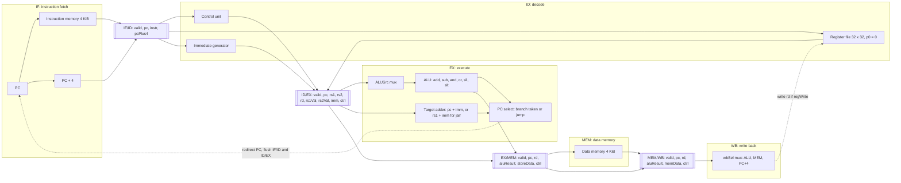

# LIMO processor block diagram (M2)

Status: M2 design. Assumes branches and jumps resolve in EX with predict-not-taken (M1 log (c); team vote in issue #26). Field names match `docs/pipeline-registers.md`.

## Legend
- Double-bracket boxes are interstage (microarchitectural) registers.
- Solid arrows carry data; dotted arrows are feedback or control paths.
- PC and the register file are architectural state; everything inside `[[ ]]` is not.

## Datapath explanation
1. **IF.** The PC addresses instruction memory; PC + 4 is computed alongside. Both go into IF/ID.
2. **ID.** The control unit decodes the instruction, the register file is read (p0 always 0), and the immediate generator sign-extends the immediate. Results go into ID/EX together with the control record.
3. **EX.** The ALUSrc mux picks rs2 or the immediate for the ALU's second operand. The ALU computes the result or the branch comparison; the target adder computes the branch or jump target. If a branch is taken or a jump executes, PC is redirected and the two younger instructions (in IF/ID and ID/EX) become bubbles.
4. **MEM.** Only loads and stores touch data memory; other instructions pass aluResult through.
5. **WB.** The wbSel mux chooses ALU result, loaded word, or PC + 4 (for tlola and khutla) and writes rd when regWrite is set.

## Planned for M4 (not implemented, not drawn as working)
- Forwarding muxes (ForwardA/B) in front of the ALU, from EX/MEM and MEM/WB.
- Load-use hazard unit that stalls PC and IF/ID for one cycle.

## Assumptions to confirm
- Branch comparison happens in the ALU, not in a separate comparator.
- jalr takes its target from rs1 + imm via the target adder.
- Register file: written in the first half-cycle, read in the second (M1 timing note).
- Branch and jump resolution in EX (pending vote #26). If the team chooses ID, the redirect arrow starts in ID, only IF/ID is flushed, and a comparator plus forwarding into ID are added.
